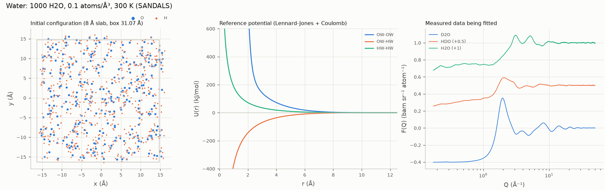
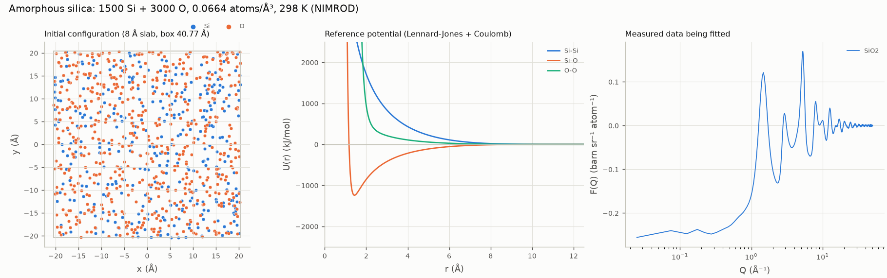
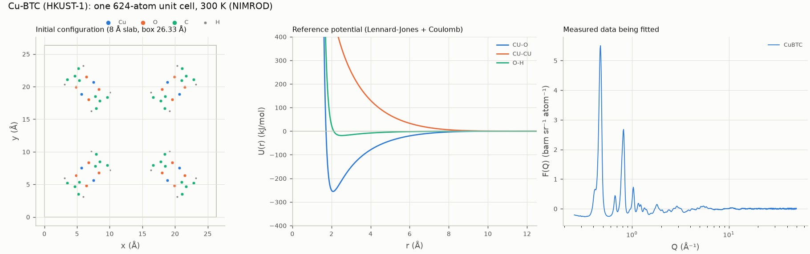

# EPSRpy

**EPSR** (Empirical Potential Structure Refinement, A. K. Soper) turns neutron and X-ray diffraction data into atomistic models of liquids, glasses and disordered materials. It is a standard analysis route for total-scattering data at the ISIS Neutron and Muon Source and other facilities. For 30 years it has been a Fortran program run through an interactive shell, which makes it hard to install, script and reproduce.

This repository contains:

1. **`epsr`, a Python package** (the main focus of development) that drives the Rust engine in-process. It returns NumPy arrays, runs refinement loops and draws figures.
2. **A Rust translation of the whole Fortran EPSR suite**: the `epsr` engine and all 35 setup and analysis programs. It is a drop-in replacement for the Fortran, verified **byte for byte** against the original.
3. **The original Fortran source**, its test case, 115 feature test problems and measured neutron data used for validation.

> **Status**
>
> - ✅ Byte-identical to the Fortran on the supplied test case, 115 feature tests and 3 real-data refinements, at every step
> - ✅ Identical output at any thread count
> - ✅ 5 bugs in the original Fortran found and fixed, including one that silently corrupts three-body energies

Everything is MIT-licensed (see [LICENSE](LICENSE)).

---

## 1. Installation

The Python package is called **`epsr-py`** and is imported as `epsr`. It contains the compiled Rust engine, so once installed it needs only Python ≥ 3.10 and NumPy. It is tested on Linux, including WSL2 on Windows.

### Linux dependencies

What you need depends on how you install. A **pre-built wheel** contains the compiled engine, so it needs only Python. Installing **from source** compiles the engine, which needs a Rust toolchain and a C compiler. A source install is any of: a GitHub URL, a clone, the source distribution, or a platform with no wheel.

| dependency | wheel | from source | why |
|---|:---:|:---:|---|
| Python ≥ 3.10 with `venv` | ✔ | ✔ | the package; `venv` creates the virtual environment it is installed into |
| pip ≥ 21.3 | ✔ | ✔ | older pip does not recognise the manylinux wheels (before 19.3) or cannot build from a folder that refers to `../rust` (before 21.3) |
| git | | ✔ | to clone the repository, or for pip to fetch it from GitHub |
| Rust toolchain (stable, ≥ 1.85) | | ✔ | compiles the engine (`rustc`, `cargo`) |
| C compiler and linker (`cc`) | | ✔ | Rust links the extension module with the system linker |
| internet access while installing | ✔ | ✔ | pip downloads NumPy; from source, also the build tool (maturin), and cargo downloads the Rust crates (PyO3, rayon) |
| OpenGL, EGL and X11 libraries | `viewer` extra only | `viewer` extra only | the 3D viewer (VTK, through pyvista) loads them at run time |

matplotlib, SciPy, NumPy, pandas and VTK all come as wheels with their own compiled code. They need no other system packages.

**Debian / Ubuntu / WSL2:**

```bash
sudo apt update
sudo apt install python3 python3-venv python3-pip git build-essential curl
sudo apt install libgl1 libegl1 libx11-6 libxcursor1          # only for the viewer extra
```

**Fedora / RHEL / Rocky / AlmaLinux:**

```bash
sudo dnf install python3 python3-pip git gcc curl
sudo dnf install mesa-libGL mesa-libEGL libX11 libXcursor     # only for the viewer extra
```

**Arch / Manjaro:**

```bash
sudo pacman -S python python-pip git base-devel curl
sudo pacman -S mesa libglvnd libx11 libxcursor                # only for the viewer extra
```

**Rust (all distributions).** Install Rust with [rustup](https://rustup.rs), not the distribution's package: those are often older than 1.85 (Ubuntu 24.04 ships 1.75). rustup installs into your home folder and needs no `sudo`:

```bash
curl --proto '=https' --tlsv1.2 -sSf https://sh.rustup.rs | sh -s -- -y
source "$HOME/.cargo/env"           # or open a new terminal
rustup update stable                # later, to update an existing installation
```

**If the distribution's Python is older than 3.10** (Debian 11, Ubuntu 20.04, RHEL 8), get a newer one without touching the system Python, for example with [uv](https://docs.astral.sh/uv/):

```bash
curl -LsSf https://astral.sh/uv/install.sh | sh
uv python install 3.12
uv venv -p 3.12 .venv               # use this in place of `python3 -m venv .venv` below
```

**Check what you have:**

| check | expect |
|---|---|
| `python3 --version` | 3.10 or later |
| `python3 -m venv --help` | a usage message (on Debian/Ubuntu, an error means `python3-venv` is missing) |
| `python3 -m pip --version` | 21.3 or later inside the virtual environment; update it with `pip install --upgrade pip` |
| `git --version` | any version |
| `rustc --version` and `cargo --version` | 1.85 or later |
| `cc --version` | any version (gcc or clang) |

Two optional tools are for development only: [uv](https://docs.astral.sh/uv/), for the development setup below, and `gfortran` (`sudo apt install gfortran`, `sudo dnf install gcc-gfortran`, `sudo pacman -S gcc-fortran`), to rebuild the original Fortran and re-run the comparison.

### Install with pip

Use a virtual environment:

```bash
python3 -m venv .venv
source .venv/bin/activate           # Windows: .venv\Scripts\activate
pip install --upgrade pip
```

Recent Debian, Ubuntu and Arch releases refuse `pip install` outside a virtual environment ("externally-managed-environment"). That is expected, and the environment above avoids it.

**Straight from GitHub.** pip clones the repository and compiles the engine:

```bash
pip install "epsr-py[plot] @ git+https://github.com/IzzyRodger-edb/EPSRpy#subdirectory=python"
```

**From a clone.** Do this if you also want the examples and the measured data they use:

```bash
git clone https://github.com/IzzyRodger-edb/EPSRpy
cd EPSRpy
pip install "./python[plot]"
```

The first build compiles the engine in release mode, which takes about 5–10 minutes. Then check the installation:

```bash
python -c "import epsr; print(epsr.__version__, epsr.VERSION_DATE)"     # 0.1.0 26: 2017-03-10
```

The optional extras go in the square brackets, separated by commas (e.g. `[plot,viewer]`):

| extra | adds | for |
|---|---|---|
| `plot` | matplotlib, scipy | `epsr.plot` figures and the `epsr.vis` refinement analysis |
| `viewer` | pyvista, imageio, imageio-ffmpeg | 3D configuration views and movies |
| `pandas` | pandas | tables as DataFrames |
| `progress` | tqdm | progress bars in refinement loops |
| `all` | all of the above | |

Installing also adds the `epsrvis` command, which draws reports, 3D views and movies of a recorded refinement (`epsrvis --help`).

**Pre-built wheels.** A wheel carries the compiled engine, so it installs in seconds with no Rust toolchain. The engine is built for Python's stable ABI, so one wheel per platform serves every Python ≥ 3.10. Once a release is on PyPI, installing is simply:

```bash
pip install "epsr-py[plot]"
```

Until then, you can build a wheel from a clone and install it on any machine with the same platform:

```bash
pip install maturin
maturin build --release --strip -m python/Cargo.toml --out dist
pip install dist/epsr_py-*.whl
```

A wheel built this way works only on machines with the same or a newer glibc than the one it was built on. The workflow [`.github/workflows/wheels.yml`](.github/workflows/wheels.yml) builds portable wheels for Linux (manylinux2014, x86_64 and aarch64), macOS (Intel and Apple silicon) and Windows, plus the source distribution. Run it by hand from the Actions tab to only build them, or push a version tag such as `v0.1.0` to build them and publish them to PyPI. Publishing needs a one-time setup on pypi.org: register this repository as a trusted publisher for `epsr-py`, with workflow `wheels.yml` and environment `pypi`. The version number is the one in [`python/Cargo.toml`](python/Cargo.toml).

### Updating

pip installs a new copy only when it sees a **new version number** (the `version` in [`python/Cargo.toml`](python/Cargo.toml), which is also `epsr.__version__`). The exception is a local folder, which pip always rebuilds:

| installed from | to update |
|---|---|
| PyPI | `pip install --upgrade epsr-py` (fetches the newest release) |
| a clone | `git pull`, then `pip install "./python[plot]"` again (rebuilds even if the version is unchanged) |
| a GitHub URL | the same `pip install` command with `--force-reinstall`, unless the version number has gone up (otherwise pip reports "already satisfied" and keeps the old build) |
| a wheel file | the new wheel, with `--force-reinstall` if it has the same version |

### Run the examples

The examples read the measured data in `experimental_data/`, so run them from a clone. They work with any installation of the package:

```bash
python python/examples/07_water_from_scratch/water_from_scratch.py --quick   # about 1 minute
python python/examples/05_experimental_water.py --quick
```

### Development setup

To work on the package itself, use uv. It creates `python/.venv` with the extension installed in editable mode, together with the test and lint tools, and rebuilds the extension whenever the Rust code changes:

```bash
cd python && uv sync --all-extras          # compiles the Rust engine on first sync
uv run python examples/05_experimental_water.py --quick
uv run pytest -m "not slow" -n 4           # the quick tests; plain `uv run pytest` runs them all

# the engine on its own, as a drop-in replacement for the Fortran `epsr`
cd ../rust && cargo build --release && cargo test --release
```

## 2. The Python package

[`python/`](python/README.md) is a PyO3 extension, installed with pip or, for development, `uv sync` (see [section 1](#1-installation)). It calls the Rust engine's public API unchanged, so its output is still byte-identical to the Fortran:

```python
import epsr
project = epsr.Project.from_template("../EPSR-test", "work/dmso")
sim = project.simulation(overrides={"ntimes": 5})
summary = sim.run()                       # one EPSR run in Rust, GIL released
sim.gr_inter("O1", "H1")                  # partial g(r) as a NumPy array
history = epsr.refine(project, n_runs=20) # refinement loop with convergence history
epsr.tools.run(folder, "nwts", ["sample.NWTS.dat"])   # any of the 35 tools
```

A new system is defined in Python (atom types, molecules, the box, neutron samples with their isotopes, EPSR settings) and built by EPSR's own setup programs, with no input file written by hand.

### The objects, and the EPSR files behind them

EPSR itself is a set of programs that read and write files in one *simulation folder*. The Python objects describe what goes into those files, or give access to them:

| Python object | what it describes | EPSR file(s) it becomes or reads |
|---|---|---|
| `AtomType` | one atom type: label, element, Lennard-Jones ε and σ, charge, mass, whether it is exchangeable | the `potential` lines of a `.mol` file; the atom-type table of the `.ato` |
| `Molecule` | one molecule type: named atoms with positions, bonds, angles, rotations, restraint stiffness | `<molecule>.mol` → `makemole` → the one-molecule template `<molecule>.ato` |
| `System` | the box: which molecules and how many, density (atoms/ų), temperature | `mixato`, `randomise`, `fmole` → the box `<system>.ato` (configuration, restraints, random-number state) |
| `NeutronSample` | one measured dataset and the isotopes of its sample | the data file (`.mint01`); `<sample>.NWTS.dat` → `nwts` → the weights `<sample>.NWTStot.wts` |
| `Settings` | EPSR keyword values, with EPSR's own names (`ntimes`, `qmin`, `ereq`...) | the run-control file `<system>.EPSR.inp` and the potential file `<system>.pcof` |
| `Project` | **the simulation folder itself**: builds it (`create`), runs EPSR on it (`equilibrate`, `refine`, `run`), changes its settings (`set`) and reads it (`results`, `status`, `history`) | every file in the folder, plus `epsr_project.json` (the definitions above) |
| `Simulation` | one EPSR run on the folder, and the results it holds in memory: fits, partial g(r) and S(Q), potentials, the configuration | reads every input file; at the end of a run EPSR rewrites `.ato`, `.pcof`, `.EPSR.inp` and writes the results (`.EPSR.g01`, `.u01`, `.erg`...) |
| `Summary`, `History` | the numbers of one run (R-factor, energy, pressure, EP amplitude); a table of them over many runs | `.EPSR.out`, `.EPSR.erg` |

The folder holds the state: every EPSR run reads the files and rewrites them, so a refinement can always be continued, inspected or copied. The generated `.mol` files stay in the folder, so the molecules being simulated can be checked as EPSR sees them.

### Anatomy of a typical script

```python
import epsr
from epsr import AtomType, Molecule, NeutronSample, System

# 1. What is simulated: atom types (reference potential), molecules, the box
OW = AtomType("OW", element="O", epsilon=0.6503, sigma=3.165492, charge=-0.82,
              coarse_grain={"rmax": 1.55})
HW = AtomType("HW", element="H", epsilon=0.0, sigma=0.0, charge=0.41, mass=2.0,
              exchangeable=True)
water = Molecule.from_geometry("Water", centre=("O", OW),
                               arms=[("H1", HW, 0.976), ("H2", HW, 0.976)], angle=107.134)
system = System("waterbox", temperature=300.0, density=0.1).add(water, 1000)
print(system.pair_parameters())                     # how every pair of atom types interacts

# 2. What it is fitted to: one sample per measurement, with its isotopes
samples = [NeutronSample("D2O", "data/SLS18502-D2O.mint01", isotopes={"HW": {2: 1.0}}),
           NeutronSample("H2O", "data/SLS18498-H2O.mint01")]          # natural isotopes

# 3. Build the simulation folder (EPSR's setup programs; nothing runs yet)
project = epsr.Project.create("work/water", system, samples, settings={"rshmin": 0.7})

# 4. Run: equilibrate on the reference potential, then refine with the empirical potential
project.equilibrate(iterations=100)                 # scratch start + 99 iterations
history = project.refine(ereq=3.0, runs=2, iterations=100)

# 5. Read the results
result = project.results()                          # a Simulation over the finished folder
result.fit("D2O")                                   # data and simulated F(Q) of one sample
result.gr_inter("OW", "HW")                         # an intermolecular partial g(r)
epsr.analysis.first_peak(result.r, result.gr_inter("OW", "OW"), (2.0, 4.0))
```

With the three SANDALS samples this script is [example 07](python/examples/07_water_from_scratch/water_from_scratch.py), and its folder is byte-identical to the validated water calculation.

`epsr.vis` records every iteration and draws convergence plots, F(Q) fits and residual maps, partials, empirical potentials, coordination numbers, bond angles and 3D configurations. Examples 05–07 refine water and silica against real data.

Documentation: [user guide](python/docs/user_guide.md), [API reference](python/docs/api.md), [architecture](python/docs/architecture.md), [testing](python/docs/testing.md).

## 3. The Rust engine

[`rust/`](rust/README.md) translates EPSR version 26 (`fortran_src/epsr_standalone_rev3.f` and everything it calls) into about 35,000 lines of Rust whose only dependency is `rayon` for parallel loops. It covers every optional engine feature: X-ray data, non-cubic boxes, tethered molecules and dihedral groups, container forces, three-body terms, coordination constraints, coarse graining, pressure control, Bragg and diffuse scattering, and lattice refinement. All 35 setup and analysis programs (`makemole`, `mixato`, `fmole`, `nwts`, `partials`, `sdf`, `sharm`, …) are ported too, behind the single `epsr-rs` command. How the engine was parallelised without losing byte-identity is in [PARALLELISM_PLAN.md](PARALLELISM_PLAN.md).

`epsr-rs` takes **the same command-line arguments, reads the same input files and writes the same output files** as the Fortran programs:

```bash
# Fortran:   epsr  <folder> epsr 200DMSO400Water.EPSR.inp
epsr-rs EPSR-test/ epsr 200DMSO400Water.EPSR.inp
epsr-rs EPSR-test/ nwts DMSODWaterD.NWTS.dat      # the setup and analysis programs too
```

Because the output is byte-identical, an existing EPSR project folder (including one behind a published paper) can be continued, re-run or audited with the Rust engine and give exactly the same numbers.

**Fortran bugs found along the way.** Translating line by line exposed real defects in the original ([FORTRAN_BUGS.md](FORTRAN_BUGS.md)). The worst one: after every save, the Fortran overwrites its three-body angles (stored as cosines) with radians, so from the second iteration of any multi-iteration run that uses three-body terms the energy is wrong. In one test case the Fortran reports +1954 kJ/mol per molecule where the correct value is −39. Five such bugs are fixed in the Rust as documented, deliberate divergences. The rest are reproduced on purpose, so that the equivalence still holds, and each has a proposed fix. Inputs on which the Fortran crashes or reads uninitialised memory raise a clear "not supported by the Rust port" error instead.

---

## 4. Validation against the Fortran

**The standard is exact equivalence, not "close agreement".** Monte Carlo trajectories are chaotic: once any accept/reject decision comes out differently, the two runs drift apart for good. Byte-identical output after hundreds of coupled iterations is therefore a very strict test.


On the left, the Fortran and the Rust run the same 300-step water refinement and produce the same energy at every step. Every one of the 39 output files is identical too. On the right, both programs continue for 30 more steps. The Rust stays identical to the Fortran. A copy whose input differs only by moving one of the 1000 molecules by 10⁻⁶ Å matches for 12 steps and then diverges. Nudges of 10⁻⁵ to 10⁻² Å diverge within one or two steps. The run data and the script that draws these figures are in [docs/figures/](docs/figures/make_readme_figures.py).

The original Fortran was rebuilt as a reference (gfortran `-O2 -fno-tree-vectorize`), and the two codes were compared file by file at three levels:

| level | what was compared | result |
|---|---|---|
| **Supplied test case** ([`EPSR-test/`](EPSR-test), 200 DMSO + 400 water, three neutron data sets) | every output file over 12 chained EPSR runs, plus input variants; FNV hashes of every file are pinned in `cargo test` | byte-identical |
| **115 feature tests** ([`test_problems/`](test_problems/README.md)) | one case per feature and per tool; 232 chained passes, each with an archived Fortran reference | byte-identical (bar the 5 deliberate bug fixes) |
| **Real experimental data** ([`validation/`](validation/README.md), see [section 5](#5-refinement-of-measured-data)) | three systems built from scratch and refined for 300 iterations; Fortran, Rust CLI and Python wrapper run side by side, with **every file compared after every step** | all three cases: every step identical |

The parallel Rust also gives identical output at any thread count (`tests/thread_invariance.rs`), which fixes a data race present in the Fortran's OpenMP code.

To reproduce: [rust/docs/VALIDATION.md](rust/docs/VALIDATION.md) and [validation/README.md § How to reproduce](validation/README.md#how-to-reproduce).

---

## 5. Refinement of measured data

The port was developed against the supplied DMSO/water test case. To show that it works on data it was never tuned on, three new systems were built from scratch from the [Dissolve](https://www.projectdissolve.com/) examples and refined against measured neutron data from the ISIS Neutron and Muon Source. The Fortran, the Rust CLI and the Python wrapper were run side by side.

| case | system | data (ISIS instrument) | final R-factor |
|---|---|---|---|
| water | 1000 H₂O, 300 K | SANDALS: H₂O, D₂O, HDO | 2.3 × 10⁻⁴ (from 2.1 × 10⁻² at a random start) |
| silica | 1500 Si + 3000 O, amorphous | NIMROD | 2.3 × 10⁻⁴ |
| Cu-BTC (HKUST-1) | 624-atom MOF unit cell, with Bragg peaks | NIMROD | 1.6 × 10⁻² |

Run on the same machine, the three codes agree at every step. The overlay plots for [water](validation/water/gr_agreement.png), [silica](validation/silica_bulk/gr_agreement.png) and [Cu-BTC](validation/cu-btc/gr_agreement.png) show zero difference for every pair. The archived Fortran reference of Cu-BTC was made on another machine, and agrees only to the last digits (see the Cu-BTC example below). The measured data are in [`experimental_data/`](experimental_data/README.md).

### The three examples, set up in Python

Each system is defined with the Python setup API (`AtomType`, `Molecule` or `Framework`, `System`, `NeutronSample`, `Project`), with no EPSR input file written by hand. The figures show each system as EPSR starts it: the initial configuration the Monte Carlo starts from (a slab through the box), the reference potential the engine uses for some of the atom-type pairs, and the measured data being fitted. They are made by [`docs/figures/make_example_figures.py`](docs/figures/make_example_figures.py) from the same definitions.

#### Water: 1000 H₂O against three SANDALS isotopic samples

```python
import epsr
from epsr import AtomType, Molecule, NeutronSample, System

OW = AtomType("OW", element="O", epsilon=0.6503, sigma=3.165492, charge=-0.82,
              coarse_grain={"rmax": 1.55})
HW = AtomType("HW", element="H", epsilon=0.0, sigma=0.0, charge=0.41, mass=2.0,
              exchangeable=True)
water = Molecule.from_geometry("Water", centre=("O", OW),
                               arms=[("H1", HW, 0.976), ("H2", HW, 0.976)], angle=107.134)
system = System("waterbox", temperature=300.0, density=0.1).add(water, 1000)

data = "experimental_data/water/data"
samples = [NeutronSample("D2O", f"{data}/SLS18502-D2O.mint01", isotopes={"HW": {2: 1.0}}),
           NeutronSample("HDO", f"{data}/SLS18500-HDO5050.mint01", isotopes={"HW": {1: 0.5, 2: 0.5}}),
           NeutronSample("H2O", f"{data}/SLS18498-H2O.mint01")]

project = epsr.Project.create("work/water", system, samples, settings={"rshmin": 0.7})
project.equilibrate(iterations=100)                # scratch start + 99 on the reference potential
project.refine(ereq=3.0, runs=2, iterations=100)   # empirical potential, 3 kJ/mol
```



The complete script is [example 07](python/examples/07_water_from_scratch/water_from_scratch.py). **Validation:** the folder the API builds before the first EPSR run, and the folder after a shortened schedule, are byte-identical to the validated `validation/water/steps.txt` calculation (`tests/test_project_setup.py`). The full schedule's `epsr_run/` is identical to the committed example output (`tests/test_example_07.py`), and that output is identical to the original Fortran EPSR run on the same steps on this machine. The exceptions are the date line of `.out` and the `.qdr` trend file, which every reading of a folder rewrites.

#### Amorphous silica: 1500 Si + 3000 O against NIMROD data

```python
SI = AtomType("Si", element="Si", epsilon=0.175, sigma=1.03, charge=2.0, coarse_grain={"rmax": 1.11})
OX = AtomType("O", element="O", epsilon=0.165, sigma=3.5, charge=-1.0, coarse_grain={"rmax": 1.55})
system = System("silica", temperature=298.0, density=0.0664)
system.add(Molecule.atom(SI), 1500).add(Molecule.atom(OX), 3000)   # single-atom "molecules"

samples = [NeutronSample("SiO2", "experimental_data/silica_bulk/data/SiO2_NIMROD.mint01")]
project = epsr.Project.create("work/silica", system, samples,
                              settings={"qmin": (0.1, 0.0), "rshmin": 1.2})
project.equilibrate(iterations=100)                # no fmole: every molecule is one atom
project.refine(ereq=50.0, runs=2, iterations=100)
```



**Validation:** the folder before the first EPSR run is byte-identical to the validated `validation/silica_bulk/steps.txt` setup (`tests/test_project_setup.py`). After the full schedule, every file is byte-identical to the original Fortran EPSR's folder for the same steps on this machine (run on 2026-10-20; the API's `epsr_project.json` is the only extra file). [Example 06](python/examples/06_experimental_SiO2.py) runs the same calculation with the lower-level calls.

#### Cu-BTC (HKUST-1): a crystal from a PDB file, with Bragg peaks

```python
from epsr import Framework

types = [AtomType("CU", element="Cu", epsilon=0.02092, sigma=3.144, charge=1.098),
         AtomType("O", element="O", epsilon=0.401664, sigma=3.033, charge=-0.665),
         AtomType("C1", element="C", epsilon=0.39748, sigma=3.473, charge=0.778),
         AtomType("C2", element="C", epsilon=0.39748, sigma=3.473, charge=-0.092),
         AtomType("C3", element="C", epsilon=0.39748, sigma=3.473, charge=-0.014),
         AtomType("H", element="H", epsilon=0.06276, sigma=2.846, charge=0.109, mass=1.008)]
framework = Framework.from_pdb("validation/cu-btc/CuBTC.pdb", types, vdw_factor=0.68)
system = System("CuBTC", temperature=300.0, structure=framework)   # density from the unit cell
system.monte_carlo(tol=0.0, stepmi=0.1, stepri=0.3, stepr=0.3, stepm=1.0)

samples = [NeutronSample("CuBTC", "experimental_data/cu-btc/data/Empty-CuBTC.mint01")]
project = epsr.Project.create("work/cubtc", system, samples, settings={
    "qwidthqmax": (0.2, 5.0), "hklqmin": (0.0, 10.0, 0.0), "qmin": (0.05, 0.0), "rshmin": 0.7})
project.equilibrate(iterations=100)                # readpdb -> changeato -> nwts; crystal positions kept
project.refine(ereq=10.0, runs=2, iterations=100)
```



The complete script is [example 08](python/examples/08_cu_btc/cu_btc.py). **Validation:** the box after `readpdb` and after `changeato`, and the folder before the first EPSR run, are byte-identical to the validated `validation/cu-btc/steps.txt` calculation. After each of the four EPSR runs, every file is byte-identical to the same steps run by the earlier Python wrapper route, and to the `epsr-rs` CLI after the full schedule (`tests/test_framework.py`). EPSR enumerates the expected 80 726 Bragg reflections at 940 unique Q values.

**Against the original Fortran:** every file is also byte-identical to the Fortran's after each EPSR run (`validation/cu-btc/fortran_reference.tar.gz`). The comparison needs a correctly rounded single-precision `sinhf`, i.e. glibc 2.42 or later. With an older glibc, the reference-potential table differs in its 7th significant digit, and the Monte Carlo carries that into the last digits of the energies. The tests then skip that comparison. [`docs/plans/cu_btc_fortran_discrepancy.md`](docs/plans/cu_btc_fortran_discrepancy.md) records the investigation, and `python/docs/testing.md` the rule.

The figures below come from the water case: 1000 water molecules fitted to three SANDALS measurements, starting from a random box.


The first 100 steps use only the reference potential, which gets the general shape right. Switching on the empirical potential closes most of the remaining gap, most visibly around the main peak near Q = 2 Å⁻¹.


One model has to fit all three isotopic samples at once, and the mismatch for all three falls to about 2 × 10⁻⁴.


The refined model shows the O–O peak at 2.79 Å and the O···H hydrogen bond at 1.80 Å, and its pair distribution functions closely follow the published reference partials of Soper (2000). The reference is itself derived from water diffraction data by an EPSR-type refinement, so this is a consistency check rather than an independent measurement. The 300-step schedule is also short, which is why the O–O curve is still noisy between 3 and 5 Å.

### Limitations

* **Some Fortran bugs are reproduced on purpose.** Fixing them would change every output and break byte-identity with the original. They are listed, with proposed fixes, in [FORTRAN_BUGS.md](FORTRAN_BUGS.md).
* **Not everything around the engine is ported.** The PGPLOT/gnuplot plotting front-ends are replaced by `epsr.vis`, and `system_commands.txt` (shell configuration for the interactive EPSRshell) is not read.
* **Installation still needs a compiler.** There are no prebuilt wheels or binaries yet. Testing so far has been on Linux and WSL2.

---

## 6. The theory, in brief

A diffraction experiment on a disordered material measures the total structure factor F(Q). It is a weighted sum of the partial structure factors of every pair of atom types α, β:

$$F(Q) = \sum_{\alpha \le \beta} (2-\delta_{\alpha\beta})\, c_\alpha c_\beta\, b_\alpha b_\beta \,\big[S_{\alpha\beta}(Q) - 1\big]$$

Here c are the atomic fractions and b the scattering lengths (form factors for X-rays). Each S_αβ(Q) is the Fourier transform of a partial pair distribution function g_αβ(r). A single measurement mixes all the partials together. Isotope substitution helps: H₂O, D₂O and HDO have the same structure but different weights b, so measuring several of them gives several independent combinations of the same partials.

EPSR inverts these data with a model:

* **Monte Carlo on a reference potential.** A periodic box of molecules is simulated with a physically sensible potential: Lennard-Jones plus Coulomb, with intramolecular geometry held by harmonic constraints.
* **An empirical potential (EP).** Every few cycles, the simulated F(Q) of each data set is compared with the measurement. The residual is inverted through the weights matrix into a correction for each atom pair and added to the potential as a sum of Poisson functions in r, which pushes the simulation towards the data.
* **A cap on the EP.** The EP's total amplitude is limited by `ereq`, so the data refine the model rather than overwrite the physics.
* **Ensemble averages.** Once the fit stabilises, EPSR accumulates partial g(r), coordination numbers, bond angles and spatial density functions over many configurations.

Fit quality is given by the R-factor, the mean squared difference between data and simulation over the fitted Q range. For water refined against good neutron data it falls to a few × 10⁻⁴.

Key references: Soper, *Chem. Phys.* **202**, 295 (1996); Soper, *Phys. Rev. B* **72**, 104204 (2005); Soper, *EPSRshell user's guide*, RAL-TR-2011-012.

---

## 7. Repository map

| path | contents |
|---|---|
| [`python/`](python/README.md) | the `epsr` Python package (PyO3, distributed as `epsr-py`): bindings, `epsr.vis`, examples, tests, user guide and API reference |
| [`.github/workflows/`](.github/workflows/wheels.yml) | builds the wheels and source distribution of `epsr-py` and publishes them to PyPI on a version tag |
| [`rust/`](rust/README.md) | the Rust engine (`epsr-core`), the drop-in CLI `epsr-rs`, the Fortran reference build and comparison tools, and the architecture, Fortran-map and validation docs |
| [`fortran_src/`](fortran_src) | the original Fortran, untouched |
| [`EPSR-test/`](EPSR-test) | the original 200 DMSO / 400 water test case, the base of the test problems |
| [`test_problems/`](test_problems/README.md) | the 115 `EPSR-test-ex*` verification cases with archived Fortran references |
| [`experimental_data/`](experimental_data/README.md) | measured neutron data (water, silica, Cu-BTC, benzene), their Dissolve inputs and reference partials |
| [`validation/`](validation/README.md) | water, silica and Cu-BTC refined against measured data by the Fortran, the Rust CLI and the Python wrapper |
| [`visualisation/`](visualisation/README.md) | the per-iteration Rust recorder and the standalone `epsrvis` toolkit that `epsr.vis` grew from |
| [`docs/figures/`](docs/figures/make_readme_figures.py) | the figures in this README, the script that draws them and the run data they use |
| [`archive/`](archive/README.md) | retired components: [Mellor](archive/mellor/ARCHIVED.md), an LLM agent for EPSR refinements, kept so it can be reinitialised |
| [FORTRAN_BUGS.md](FORTRAN_BUGS.md) | bugs found in the Fortran and their status in the port |
| [PARALLELISM_PLAN.md](PARALLELISM_PLAN.md) | how the engine was parallelised without losing byte-identity |

### Acknowledgements

EPSR is the work of Alan Soper (ISIS Neutron and Muon Source, STFC). The example systems and data come from the [Dissolve](https://www.projectdissolve.com/) project (T. G. A. Youngs). The project started at Reinvent the Wheel 2026, hosted by Science Works and Inherent Laboratories.
